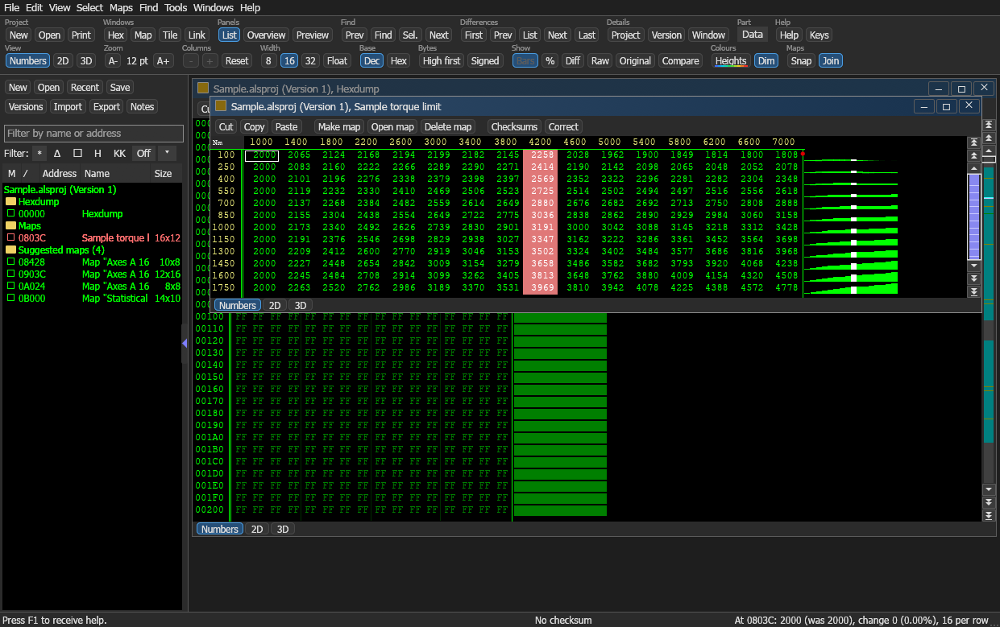
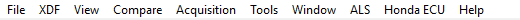
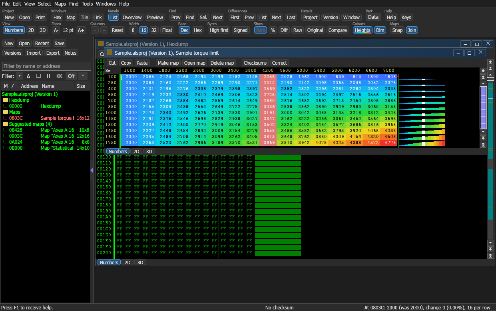
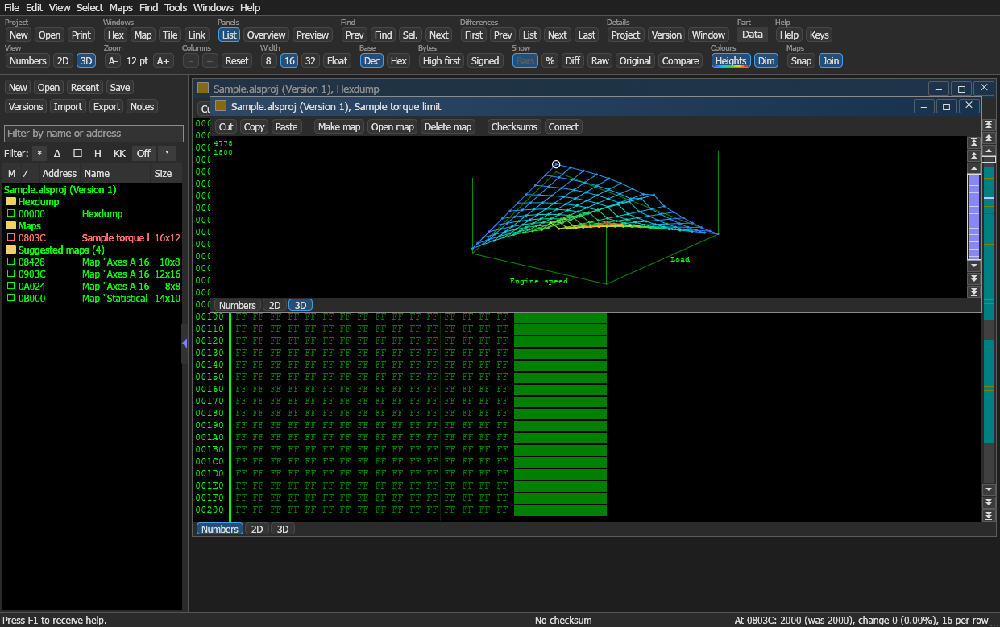

# ALS, a plug-in for TunerPro RT

Developed by AlexDev-TH

[ภาษาไทย](README.md)

ALS adds an **ALS** menu to TunerPro RT. The menu opens a window for going through a bin as a hexdump, a 2D graph and a 3D graph, to find maps, mark them, name them, give them axes and change their values. The maps then go back to TunerPro as an XDF that it opens straight away, and the tables of an existing XDF can be taken in as maps.



The menu in TunerPro



## What it does

- Opens the bin and XDF that TunerPro has open, with one click on the ALS menu
- Shows the data three ways: numbers, 2D and 3D, with the column count, 8/16/32 bit and byte order adjustable
- Turns a selection into a map with a name, unit, factor and X/Y axes
- Changes values, shows what differs from the original file, compares versions, with undo and redo
- Sends maps to TunerPro as an XDF, and takes an XDF in as maps
- Saves maps as a map pack, to use them with another file
- Automatic map search, general checksums, bookmarks and comments
- Window colours that match TunerPro in its dark and its light theme
- Height colours: each value takes a colour by how high it is, from blue (low) to red (high)





## Install

Needs 64-bit Windows 10 or 11, and TunerPro RT. Tested with TunerPro RT 5.0.10305 and 6.0.496.

1. Download [ALS-TunerPro.zip](https://github.com/AlexDev-TH/TunerPro-ALS/releases/latest/download/ALS-TunerPro.zip) and unpack all of it
2. Close TunerPro
3. Double-click `install.bat`
4. Start TunerPro. The **ALS** menu is on the menu bar

If Windows shows the blue "Windows protected your PC" window, choose **More info** and then **Run anyway**. It appears because the files carry no digital signature.

To install by hand, copy `ALS.dll` and the `ALS` folder into

```
Documents\TunerPro Files\Plugins
```

To remove it, delete `ALS.dll` and the `ALS` folder from there.

### If the window does not appear

- ALS draws with Direct3D 12 or Vulkan first, and switches to OpenGL by itself on a computer where those do not work
- If it cannot start at all, a message says why, and the reason is kept in `%APPDATA%\ALS\ALS-start.log`. Updating the graphics driver usually fixes it
- With no window and no message, check whether the antivirus program has held `ALS.exe` back (Windows Security, Protection history)
- To use OpenGL every time, make a file `%APPDATA%\ALS\drawing.txt` holding the word `opengl`
- The Visual C++ Redistributable is not needed

## Use

1. Open a bin (and an XDF, if there is one) in TunerPro, and save
2. In the **ALS** menu, choose **Open ALS with the current bin and XDF**. The tables of the XDF arrive in the map list on the left
3. Go through the data. Press `M` or `W` for more or fewer columns until the pattern of a table lines up, and `#` to switch between 8, 16 and 32 bit
4. Select the values of a table and press `K` to make a map of them. Its name, size and axes are set in the Map settings window (press `Alt+Enter`)
5. In the **File** menu, choose **Send maps to TunerPro (XDF)**, or press `Ctrl+Shift+T`. Pick a file name, and TunerPro opens that XDF

Files can also be converted by hand in the **File** menu, under **Import** and **Export**

- **Export**, **TunerPro definition (XDF)** writes all maps as a new XDF
- **Import**, **TunerPro definition (XDF)** takes the tables of an XDF in as maps
- **Map pack**, under both, keeps maps and brings them back (.alsmap files)

The map list on the left gets wider or narrower by dragging its right edge, and its columns by dragging the lines in its head. The window colours are chosen under **View**, **Window colours** (like TunerPro, light, or dark), and the height colours are switched with the **Heights** button in the **Colours** group of the toolbar.

## Keys

Files and projects

- `Ctrl+N` new project
- `Ctrl+O` open a project
- `Ctrl+Shift+O` open a version
- `Ctrl+S` save
- `Ctrl+Shift+S` save all
- `Ctrl+E` export a file
- `Ctrl+I` import a file
- `Ctrl+Shift+I` import maps
- `Ctrl+Alt+I` import changes
- `Ctrl+D` import an A2L file
- `Ctrl+Shift+T` send maps to TunerPro as an XDF
- `Ctrl+P` print
- `Ctrl+F4` close the project
- `Ctrl+Alt+Enter` project properties
- `Shift+Alt+Enter` version properties
- `Alt+Enter` window or map properties

View

- `M` more columns
- `W` fewer columns
- `#` switch between 8, 16 and 32 bit
- `T` and `Shift+T` step through Numbers, 2D and 3D
- `Z` default view
- `.` connect the dots in the 2D graph
- `Ctrl+B` fit the value range
- `Ctrl+Left` and `Ctrl+Right` move the origin by one byte
- `Ctrl+Up` and `Ctrl+Down` scroll by one row
- `Ctrl+Shift+Left` and `Ctrl+Shift+Right` turn the 3D graph
- `O` overview window
- `P` preview window
- `Ctrl+K` hide or show the map list
- `Tab` hide or show the floating windows

Maps and selection

- `K` make a map of the selection
- `Shift+K` open the map under the cursor
- `F` detect a map around the cursor
- `Shift+arrow keys` extend the selection
- `Insert` select the current cell
- `Delete` clear the selection
- `Ctrl+A` select the whole screen
- `Ctrl+Shift+B` and `Ctrl+Shift+K` set the beginning and the end of the selection
- `Ctrl+R` load a selection from a file
- `Ctrl+W` save the selection to a file

Changing values

- `Enter`, or typing a number, edits the cell
- `+` and `-` one step up or down
- `=` change to a set value
- `%` change by a percentage
- `/` change gradually from the corners of the selection
- `F9` repeat the last change
- `F11` put the original value back
- `Ctrl+Z` and `Ctrl+Y` undo and redo
- `Ctrl+C` `Ctrl+X` `Ctrl+V` copy, cut, paste

Search and moving around

- `S` or `Ctrl+F` search
- `Ctrl+Shift+F` search for the selection
- `F3` `Shift+F3` `Alt+F3` next, previous, and from the start
- `A` or `Ctrl+G` go to an address
- `PageUp` and `PageDown` one page
- `Ctrl+PageUp` and `Ctrl+PageDown` jump by 8000h bytes
- `Home` and `End` start and end of the row
- `Ctrl+Home` and `Ctrl+End` start and end of the file
- `F5` `Shift+F5` `Ctrl+F5` next marker, previous marker, set or clear a marker

Differences and the rest

- `U` or `Ctrl+U` list of values that differ from the original file
- `E` `V` `N` `L` first, previous, next and last difference
- `Shift+V` and `Shift+N` previous and next comment
- `Shift+Enter` edit a comment
- `C` or `F2` checksums
- `Alt+F2` recalculate the checksum
- `F12` settings
- `F1` help

## ALS files

- `.alsproj` a project (data, versions and maps)
- `.alsmap` a map pack
- `.alssel` a saved selection

## Good to know

- ALS reads the bin and the XDF as saved on disk. It doesn't see unsaved changes in TunerPro
- When TunerPro has an XDF open, sending adds only the new maps to a copy of that XDF. Everything already in the file stays, and the original file isn't changed
- Switches (flags) and patches of an XDF have no map form and aren't taken in
- A protected XDF can't be read
- Values changed in ALS stay in the ALS project. Use **File**, **Export**, **Data file** to take them elsewhere
- Thai text in an XDF is written the TunerPro 5 way (code page 874 bytes as `&#nnn;`)
- This program doesn't read from or write to an ECU

## Build from source

Needs [Rust](https://www.rust-lang.org/), and Visual Studio with the C++ desktop tools.

```
build.bat
install.bat
```

`build.bat` makes `dist\ALS.dll` (the 32-bit plug-in), `dist\ALS\ALS.exe` and `dist\ALS-TunerPro.zip`. `install.bat` copies the files into TunerPro's plug-in folder.

Run the tests

```
cd app
cargo test
```

Folders

- `plugin` the TunerPro plug-in (C++): adds the menu, starts the program, takes the XDF back
- `app` the ALS program (Rust with egui)
- `docs` pictures

## Developing further

This source contains no files from the TunerPro Plug-in SDK. The plug-in declares the few structures it needs itself, in `plugin/plugin.cpp`.

To develop further with the SDK, for example a data acquisition driver or an emulator driver, ask Mark Mansur, the developer of TunerPro, for the SDK at [tunerpro.net](https://www.tunerpro.net). The SDK may not be passed on, so please don't add its files to this repository.

## Notes

ALS is independent work by AlexDev-TH. It is not part of TunerPro and is not connected with Mark Mansur or any other software maker. Product names and trademarks mentioned belong to their owners.

The icon on the title bar is read from the copy of TunerPro installed on the user's computer when the program starts. No TunerPro files are included in this work.

Changing ECU data carries risk. You are responsible for what you do with it.

## Licence

[MIT](LICENSE)
