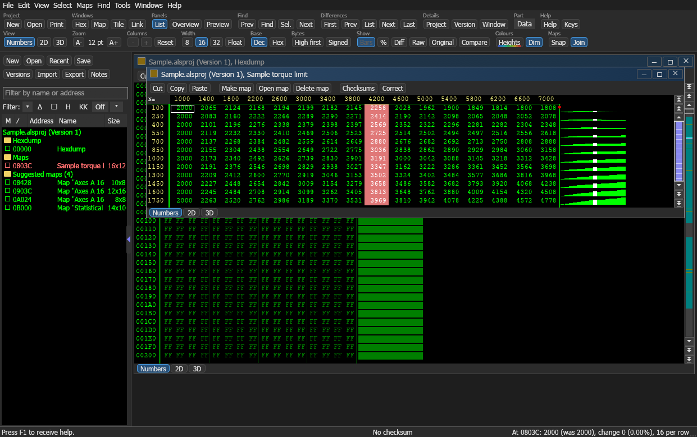
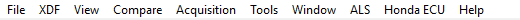
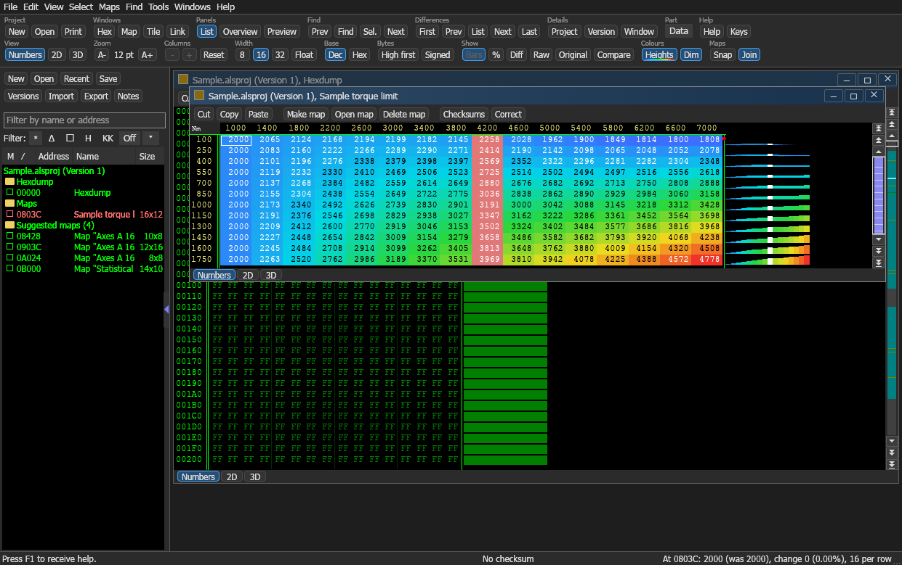
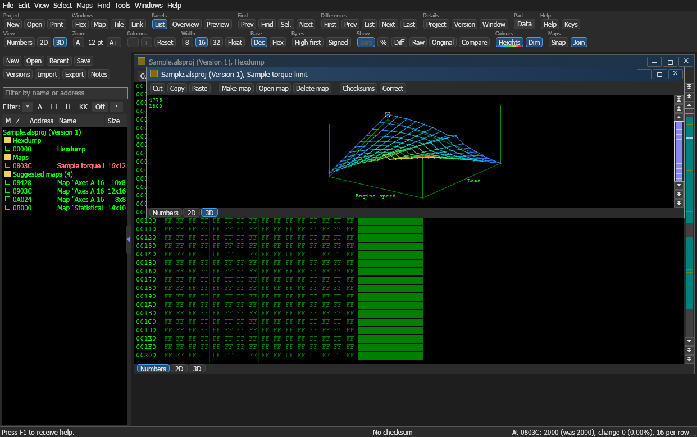

# ALS ปลั๊กอินสำหรับ TunerPro RT

พัฒนาโดย AlexDev-TH

[English](README.en.md)

ALS เพิ่มเมนู **ALS** ให้ TunerPro RT กดแล้วเปิดหน้าต่างสำหรับไล่ดูไฟล์ bin แบบ hexdump กราฟ 2D และ 3D เพื่อหาแมพ ครอบแมพ ตั้งชื่อ ใส่แกน และปรับค่า เสร็จแล้วส่งแมพกลับไปเป็น XDF ให้ TunerPro เปิดต่อได้ทันที และดึงตารางจาก XDF ที่มีอยู่เข้ามาเป็นแมพได้เช่นกัน



เมนูใน TunerPro



## ทำอะไรได้

- เปิด bin และ XDF ที่ TunerPro เปิดอยู่จากเมนู ALS ได้ในคลิกเดียว
- ดูข้อมูลได้ 3 แบบ คือ ตัวเลข (Numbers) กราฟ 2D และ 3D ปรับจำนวนคอลัมน์ 8/16/32 บิต และลำดับไบต์ได้
- ลากเลือกข้อมูลแล้วสร้างเป็นแมพ ตั้งชื่อ หน่วย ตัวคูณ และแกน X/Y
- แก้ค่าในแมพ ดูค่าที่ต่างจากไฟล์เดิม เทียบเวอร์ชัน และ undo/redo
- ส่งแมพกลับไป TunerPro เป็น XDF และดึง XDF เข้ามาเป็นแมพ
- บันทึกแมพเป็น map pack เพื่อเอาไปใช้กับไฟล์อื่น
- ค้นหาแมพอัตโนมัติ เช็กซัมแบบทั่วไป บุ๊กมาร์ก และคอมเมนต์ในไฟล์
- สีหน้าต่างเข้ากับ TunerPro ทั้งธีมมืดและธีมสว่าง
- โหมด height colours ระบายสีค่าตามความสูง จากน้ำเงิน (ต่ำ) ไปแดง (สูง)





## ติดตั้ง

ต้องมี Windows 10 หรือ 11 แบบ 64 บิต และ TunerPro RT ทดสอบกับ TunerPro RT 5.0.10305 และ 6.0.496

1. โหลด [ALS-TunerPro.zip](https://github.com/AlexDev-TH/TunerPro-ALS/releases/latest/download/ALS-TunerPro.zip) แล้วแตกไฟล์ทั้งหมดออกมา
2. ปิด TunerPro
3. ดับเบิลคลิก `install.bat`
4. เปิด TunerPro จะมีเมนู **ALS** อยู่บนแถบเมนู

ถ้า Windows ขึ้นหน้าต่างสีน้ำเงิน "Windows protected your PC" ให้กด **More info** แล้วกด **Run anyway** ข้อความนี้ขึ้นเพราะไฟล์ไม่ได้เซ็นลายเซ็นดิจิทัล

ติดตั้งเองก็ได้ โดยคัดลอก `ALS.dll` และโฟลเดอร์ `ALS` ไปไว้ที่

```
Documents\TunerPro Files\Plugins
```

ถอนการติดตั้ง ให้ลบ `ALS.dll` และโฟลเดอร์ `ALS` ออกจากโฟลเดอร์นั้น

### ถ้ากดเปิดแล้วหน้าต่างไม่ขึ้น

- ALS วาดหน้าจอด้วย Direct3D 12 หรือ Vulkan ก่อน ถ้าเครื่องใช้ไม่ได้จะสลับไปใช้ OpenGL เอง
- ถ้าเปิดไม่ได้เลย จะมีข้อความบอกสาเหตุ และบันทึกไว้ในไฟล์ `%APPDATA%\ALS\ALS-start.log` ส่วนใหญ่แก้ได้ด้วยการอัปเดตไดรเวอร์การ์ดจอ
- ถ้าไม่มีทั้งหน้าต่างและข้อความ ให้ดูว่าโปรแกรมป้องกันไวรัสกักไฟล์ `ALS.exe` ไว้หรือไม่ (Windows Security หัวข้อ Protection history)
- บังคับให้ใช้ OpenGL ทุกครั้งได้ โดยสร้างไฟล์ `%APPDATA%\ALS\drawing.txt` ที่มีคำว่า `opengl`
- ไม่ต้องติดตั้ง Visual C++ Redistributable

## วิธีใช้

1. เปิด bin (และ XDF ถ้ามี) ใน TunerPro แล้วเซฟให้เรียบร้อย
2. เมนู **ALS** เลือก **เปิด ALS กับไฟล์ที่เปิดอยู่ (bin + XDF)** ตารางใน XDF จะเข้ามาอยู่ในรายการแมพด้านซ้าย
3. ไล่ดูข้อมูล กด `M` หรือ `W` เพื่อเพิ่มหรือลดจำนวนคอลัมน์จนลายของตารางเรียงตัว กด `#` เพื่อสลับ 8/16/32 บิต
4. ลากเลือกข้อมูลของตาราง แล้วกด `K` เพื่อสร้างเป็นแมพ ตั้งชื่อ ขนาด และแกนได้ในหน้าต่าง Map settings (กด `Alt+Enter`)
5. เมนู **File** เลือก **Send maps to TunerPro (XDF)** หรือกด `Ctrl+Shift+T` เลือกชื่อไฟล์ แล้ว TunerPro จะเปิด XDF นั้นให้

แปลงไฟล์เองได้ที่เมนู **File** หัวข้อ **Import** และ **Export**

- **Export** แล้ว **TunerPro definition (XDF)** เขียนแมพทั้งหมดเป็น XDF ไฟล์ใหม่
- **Import** แล้ว **TunerPro definition (XDF)** ดึงตารางจาก XDF เข้ามาเป็นแมพ
- **Map pack** ในทั้งสองหัวข้อ สำหรับเก็บแมพและนำกลับมาใช้ (ไฟล์ .alsmap)

แถบรายการแมพด้านซ้ายลากขอบขวาเพื่อขยายหรือย่อได้ และลากเส้นแบ่งที่หัวคอลัมน์เพื่อปรับความกว้างของคอลัมน์ได้ สีหน้าต่างเลือกได้ที่เมนู **View** หัวข้อ **Window colours** (ตาม TunerPro สว่าง หรือมืด) และเปิดปิด height colours ได้จากปุ่ม **Heights** ในกลุ่ม **Colours** บนแถบเครื่องมือ

## คีย์ลัด

ไฟล์และโปรเจกต์

- `Ctrl+N` โปรเจกต์ใหม่
- `Ctrl+O` เปิดโปรเจกต์
- `Ctrl+Shift+O` เปิดเวอร์ชัน
- `Ctrl+S` บันทึก
- `Ctrl+Shift+S` บันทึกทั้งหมด
- `Ctrl+E` ส่งออกไฟล์
- `Ctrl+I` นำเข้าไฟล์
- `Ctrl+Shift+I` นำเข้าแมพ
- `Ctrl+Alt+I` นำเข้าการแก้ไข
- `Ctrl+D` นำเข้าไฟล์ A2L
- `Ctrl+Shift+T` ส่งแมพไป TunerPro เป็น XDF
- `Ctrl+P` พิมพ์
- `Ctrl+F4` ปิดโปรเจกต์
- `Ctrl+Alt+Enter` คุณสมบัติโปรเจกต์
- `Shift+Alt+Enter` คุณสมบัติเวอร์ชัน
- `Alt+Enter` คุณสมบัติหน้าต่างหรือแมพ

มุมมอง

- `M` เพิ่มคอลัมน์
- `W` ลดคอลัมน์
- `#` สลับ 8/16/32 บิต
- `T` และ `Shift+T` สลับมุมมอง Numbers 2D 3D
- `Z` มุมมองเริ่มต้น
- `.` ลากเส้นเชื่อมจุดในกราฟ 2D
- `Ctrl+B` ปรับช่วงค่าให้พอดี
- `Ctrl+ซ้าย` และ `Ctrl+ขวา` เลื่อนจุดเริ่มทีละไบต์
- `Ctrl+ขึ้น` และ `Ctrl+ลง` เลื่อนทีละแถว
- `Ctrl+Shift+ซ้าย` และ `Ctrl+Shift+ขวา` หมุนกราฟ 3D
- `O` หน้าต่างภาพรวม
- `P` หน้าต่างพรีวิว
- `Ctrl+K` ซ่อนหรือแสดงรายการแมพ
- `Tab` ซ่อนหรือแสดงหน้าต่างลอย

แมพและการเลือก

- `K` สร้างแมพจากส่วนที่เลือก
- `Shift+K` เปิดแมพที่เคอร์เซอร์อยู่
- `F` ตรวจหาแมพรอบเคอร์เซอร์
- `Shift+ลูกศร` ขยายส่วนที่เลือก
- `Insert` เลือกช่องปัจจุบัน
- `Delete` ยกเลิกการเลือก
- `Ctrl+A` เลือกทั้งหน้าจอ
- `Ctrl+Shift+B` และ `Ctrl+Shift+K` กำหนดจุดเริ่มและจุดจบของส่วนที่เลือก
- `Ctrl+R` โหลดส่วนที่เลือกจากไฟล์
- `Ctrl+W` บันทึกส่วนที่เลือกเป็นไฟล์

แก้ค่า

- `Enter` หรือพิมพ์ตัวเลข แก้ค่าในช่อง
- `+` และ `-` เพิ่มหรือลดค่าทีละขั้น
- `=` เปลี่ยนค่าแบบกำหนดเอง
- `%` เปลี่ยนค่าเป็นเปอร์เซ็นต์
- `/` เปลี่ยนค่าแบบไล่ระดับจากมุมของส่วนที่เลือก
- `F9` ทำการเปลี่ยนค่าครั้งล่าสุดซ้ำ
- `F11` คืนค่าเดิม
- `Ctrl+Z` และ `Ctrl+Y` ย้อนกลับและทำซ้ำ
- `Ctrl+C` `Ctrl+X` `Ctrl+V` คัดลอก ตัด วาง

ค้นหาและเลื่อน

- `S` หรือ `Ctrl+F` ค้นหา
- `Ctrl+Shift+F` ค้นหาส่วนที่เลือก
- `F3` `Shift+F3` `Alt+F3` ค้นหาถัดไป ก่อนหน้า และเริ่มจากต้นไฟล์
- `A` หรือ `Ctrl+G` ไปที่ตำแหน่ง
- `PageUp` และ `PageDown` เลื่อนทีละหน้า
- `Ctrl+PageUp` และ `Ctrl+PageDown` กระโดดทีละ 8000h ไบต์
- `Home` และ `End` ต้นแถวและท้ายแถว
- `Ctrl+Home` และ `Ctrl+End` ต้นไฟล์และท้ายไฟล์
- `F5` `Shift+F5` `Ctrl+F5` มาร์กถัดไป ก่อนหน้า และตั้งหรือลบมาร์ก

เทียบค่าและอื่น ๆ

- `U` หรือ `Ctrl+U` รายการค่าที่ต่างจากไฟล์เดิม
- `E` `V` `N` `L` ไปยังค่าที่ต่างตัวแรก ก่อนหน้า ถัดไป และสุดท้าย
- `Shift+V` และ `Shift+N` คอมเมนต์ก่อนหน้าและถัดไป
- `Shift+Enter` แก้คอมเมนต์
- `C` หรือ `F2` เช็กซัม
- `Alt+F2` คำนวณเช็กซัมใหม่
- `F12` ตั้งค่า
- `F1` วิธีใช้

## ไฟล์ของ ALS

- `.alsproj` โปรเจกต์ (ข้อมูล เวอร์ชัน และแมพ)
- `.alsmap` map pack
- `.alssel` ส่วนที่เลือกที่บันทึกไว้

## ควรรู้

- ALS อ่าน bin และ XDF จากไฟล์ที่เซฟไว้ ไม่เห็นการแก้ไขใน TunerPro ที่ยังไม่ได้เซฟ
- ตอนส่งกลับ ถ้า TunerPro มี XDF เปิดอยู่ ALS จะเติมเฉพาะแมพใหม่ลงในสำเนาของ XDF นั้น ของเดิมในไฟล์อยู่ครบและไฟล์ต้นฉบับไม่ถูกแก้
- สวิตช์ (flag) และ patch ใน XDF ไม่มีรูปแบบเป็นแมพ จึงไม่ถูกดึงเข้ามา
- XDF ที่เข้ารหัสไว้ อ่านไม่ได้
- ค่าที่แก้ใน ALS อยู่ในโปรเจกต์ของ ALS ถ้าจะเอาไปใช้ต่อให้ส่งออกที่เมนู **File** หัวข้อ **Export** แล้ว **Data file**
- ข้อความไทยใน XDF เขียนแบบ TunerPro 5 (ไบต์ cp874 เป็น `&#nnn;`)
- ไม่มีการอ่านเขียนกล่อง ECU ในโปรแกรมนี้

## บิลด์จากซอร์ส

ต้องมี [Rust](https://www.rust-lang.org/) และ Visual Studio ที่ลง C++ desktop tools

```
build.bat
install.bat
```

`build.bat` ได้ `dist\ALS.dll` (ปลั๊กอิน 32 บิต) `dist\ALS\ALS.exe` และ `dist\ALS-TunerPro.zip` ส่วน `install.bat` คัดลอกไฟล์ไปไว้ที่โฟลเดอร์ปลั๊กอินของ TunerPro

รันชุดทดสอบ

```
cd app
cargo test
```

โครงสร้างโฟลเดอร์

- `plugin` ตัวปลั๊กอินของ TunerPro (C++) เพิ่มเมนู เปิดโปรแกรม และรับ XDF กลับ
- `app` ตัวโปรแกรม ALS (Rust กับ egui)
- `docs` ภาพประกอบ

## พัฒนาต่อ

ซอร์สนี้ไม่มีไฟล์จาก TunerPro Plug-in SDK ปลั๊กอินประกาศโครงสร้างที่ต้องใช้เองใน `plugin/plugin.cpp`

ถ้าจะพัฒนาต่อด้วย SDK เช่น ทำไดรเวอร์ data acquisition หรือ emulator ต้องขอ SDK จาก Mark Mansur ผู้พัฒนา TunerPro โดยตรงที่ [tunerpro.net](https://www.tunerpro.net) เพราะ SDK ไม่อนุญาตให้แจกต่อ และอย่าใส่ไฟล์ของ SDK ลงใน repo นี้

## หมายเหตุ

ALS เป็นงานอิสระของ AlexDev-TH ไม่ได้เป็นส่วนหนึ่งของ TunerPro และไม่เกี่ยวข้องกับ Mark Mansur หรือผู้ผลิตซอฟต์แวร์รายอื่น ชื่อผลิตภัณฑ์และเครื่องหมายการค้าที่กล่าวถึงเป็นของเจ้าของแต่ละราย

ไอคอนบนไตเติ้ลบาร์อ่านจาก TunerPro ที่ติดตั้งในเครื่องของผู้ใช้ตอนเปิดโปรแกรม ไม่มีไฟล์ของ TunerPro รวมอยู่ในงานนี้

การแก้ไขข้อมูลกล่อง ECU มีความเสี่ยง ผู้ใช้รับผิดชอบผลที่เกิดขึ้นเอง

## ใบอนุญาต

[MIT](LICENSE)
